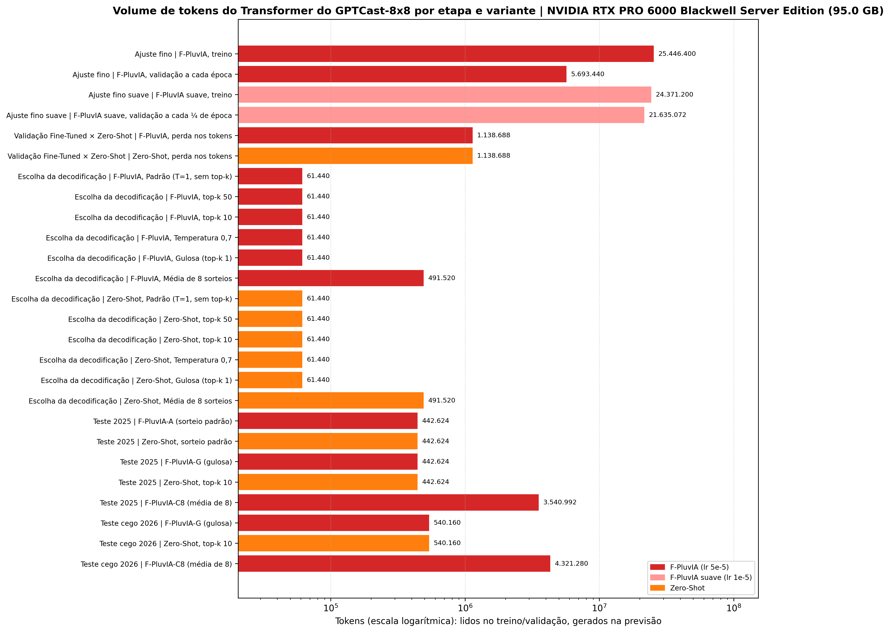
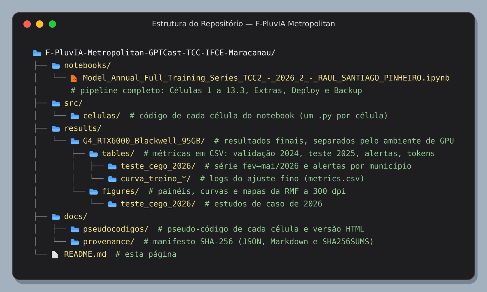

# ⛈️ F-PluvIA Metropolitan: Nowcasting de Precipitação na Região Metropolitana de Fortaleza via Adaptação de Domínio Cross-Sensor do GPTCast-8x8

[](https://ifce.edu.br/maracanau)
[-3776AB?style=flat-square&logo=python&logoColor=white)](https://www.python.org/)
[](https://pytorch.org/)
[](https://gpm.nasa.gov/data/imerg)
[](#-custo-computacional)

> **Trabalho de Conclusão de Curso (TCC)**, no formato de artigo científico — Bacharelado em Ciência da Computação (2026.2)
> **Instituto Federal de Educação, Ciência e Tecnologia do Ceará (IFCE) — Campus Maracanaú**
> **Autor:** Raul Santiago Pinheiro · **Orientador:** Amauri Holanda de Souza Júnior

---

## 📌 Visão Geral

O **F-PluvIA Metropolitan** avalia se um modelo generativo de *nowcasting* de precipitação (previsão de +30 a +120 minutos), treinado originalmente com radar meteorológico, pode ser adaptado para estimativas de satélite nos **19 municípios da Região Metropolitana de Fortaleza (RMF)**.

O ponto de partida é o **GPTCast-8x8** (Franch et al., 2025), treinado pela Fondazione Bruno Kessler com dados de radar do norte da Itália. Este trabalho faz o ajuste fino do modelo com o produto de satélite **NASA/JAXA GPM IMERG v7**, reamostrado para uma malha de **2 km** (128 × 128 pixels) sobre a RMF, e o compara com métodos clássicos de extrapolação da biblioteca `pysteps` (LINDA e fluxo óptico Lucas-Kanade) e com a persistência.

---

## 🏗️ Arquitetura e Ajuste Fino

O modelo tem **395,64 milhões de parâmetros** em dois estágios:

1. **Estágio 1 — VQGAN (90,71 M parâmetros, 22,93 %, congelada):** codifica cada quadro de 128 × 128 pixels em 8 × 8 = 64 *tokens*, cada um o índice de um dos 1.024 vetores do *codebook* (um bloco de 16 × 16 pixels, ≈ 32 km).
   - **Teto de reconstrução** (codificar e decodificar quadros observados de 2024, sem previsão): a chuva cai no lugar certo (CSI 0,85 a 0,5 mm/h, deslocamento ≈ 2,7 km), mas com a textura do radar de origem: volume 17 % acima do observado e estrutura mais fragmentada (S ≈ −0,31 no diagrama SAL).

2. **Estágio 2 — Transformer com arquitetura GPT-2 (304,93 M parâmetros, 77,07 %, ajustado):** prevê o próximo *token* a partir dos anteriores, com contexto máximo de 512 *tokens* (8 quadros × 64). Os pesos vêm do checkpoint do GPTCast; nenhum peso da OpenAI é usado.
   - **Previsão:** recebe 7 quadros (3,5 horas) e gera os 4 horizontes (+30, +60, +90 e +120 min), um *token* por vez.
   - **Tokenização empilhada:** os 8 quadros entram na VQGAN como uma única imagem, como no treino original e na previsão do GPTCast.

**Ajuste fino** (GPU NVIDIA RTX PRO 6000 Blackwell, 95 GB): taxa de aprendizado 5 × 10⁻⁵, lote 16, precisão `bf16-mixed`, parada antecipada pela perda de validação de 2024.

| Medida (validação 2024, 2.224 janelas) | Zero-Shot | F-PluvIA |
| :--- | :---: | :---: |
| Entropia cruzada (nats/*token*) | 5,1776 | **4,7167** |
| Perplexidade | 177,2 | **111,8** (−36,9 %) |

- O melhor checkpoint veio da **primeira época**. Depois dela, a perda de treino continuou caindo e a de validação subiu (5,53 na quinta época): sobreajuste.
- Uma taxa cinco vezes menor (1 × 10⁻⁵, validação a cada ¼ de época) chegou ao mesmo patamar (4,7181) e não foi adotada.

### Decodificação

O mesmo modelo ajustado gera previsões diferentes conforme a forma de escolher cada *token*. As estratégias foram comparadas **na validação de 2024**, antes de qualquer teste:

| Produto | Decodificação | Uso |
| :--- | :--- | :--- |
| **F-PluvIA-G** | Gulosa (*top-k* 1) | **Produto principal**, escolhido na validação |
| F-PluvIA-C8 | Média de 8 sorteios | Conjunto (*ensemble*) de alta detecção |
| F-PluvIA-A | Sorteio padrão do pacote (T = 1) | Referência; o pior no teste de 2025 |
| Zero-Shot | *Top-k* 10 | Modelo original, sem ajuste fino |

---

## 🛰️ Dados

| Parâmetro | Especificação |
| :--- | :--- |
| **Treino, validação e teste** | NASA GPM IMERG **Final Run** v7 (IMERG-FR, calibrado com pluviômetros) |
| **Teste cego 2026** | NASA GPM IMERG **Late Run** v7 (IMERG-LR, tempo quase real) |
| **Período** | Quadra chuvosa do Ceará (fev–mai) de 2019 a 2025: **28 meses** |
| **Malha** | 128 × 128 pixels a 2 km (256 × 256 km), por interpolação bicúbica. A resolução efetiva continua a do IMERG (≈ 10 km) |
| **Conversão** | Chuva limitada a [0, 205] mm/h e convertida para [0, 60] dBZ por Marshall-Palmer (`Z = 200·R^1,6`) |
| **Janelas** | **13.893** sequências de **11 quadros** (passo de 30 min, uma janela a cada 60 min), só com chuva |

**Divisão cronológica estrita** (sem sobreposição entre anos):

| Partição | Período | Janelas | Proporção | Papel |
| :--- | :---: | :---: | :---: | :--- |
| **Treino** | 2019–2023 | 9.940 | 71,5 % | Ajuste fino (recorte aleatório de 8 dos 11 quadros) |
| **Validação** | 2024 | 2.224 | 16,0 % | Parada antecipada e escolha da decodificação |
| **Teste** | 2025 | 1.729 | 12,4 % | Avaliação independente |
| **Teste cego** | 2026 (IMERG-LR) | 2.108 | — | Ano e produto nunca vistos |

---

## 📊 Principais Resultados

### Média de todos os horizontes (+30 a +120 min)

| Método | CSI ≥ 1 mm/h 2025 | CSI ≥ 1 mm/h 2026 | MAE 2025 [mm/h] | MAE 2026 [mm/h] | Volume previsto/observado 2025 | Volume 2026 |
| :--- | :---: | :---: | :---: | :---: | :---: | :---: |
| **F-PluvIA-G** | 0,400 | 0,359 | 0,455 | 0,414 | **1,077** | **1,084** |
| F-PluvIA-C8 | 0,338 | 0,301 | 0,510 | 0,467 | 1,239 | 1,253 |
| Zero-Shot (*top-k* 10) | 0,420 | 0,366 | 0,823 | 0,634 | 2,100 | 1,760 |
| LINDA (`pysteps`) | **0,487** | **0,418** | 0,330 | 0,332 | 1,020 | 1,048 |
| Lucas-Kanade (`pysteps`) | 0,475 | 0,414 | **0,312** | **0,310** | 0,890 | 0,919 |
| Persistência | 0,426 | 0,385 | 0,373 | 0,347 | 1,001 | 1,004 |

### Alertas por município (F1 em %, média de +30 a +120 min)

| Método | Atenção ≥ 0,5 mm/h 2025 | Atenção 2026 | Alerta ≥ 1 mm/h 2025 | Alerta 2026 | Severo ≥ 5 mm/h 2025 | Severo 2026 |
| :--- | :---: | :---: | :---: | :---: | :---: | :---: |
| **F-PluvIA-G** | 70,1 | 64,0 | 68,2 | 58,5 | 49,6 | 34,1 |
| F-PluvIA-C8 | 59,2 | 55,0 | 59,9 | 51,3 | 53,6 | 35,9 |
| Zero-Shot (*top-k* 10) | 70,4 | 63,0 | 67,3 | 56,9 | 40,9 | 27,7 |
| LINDA | 72,4 | 64,1 | 71,0 | 59,2 | 60,7 | 38,9 |
| Lucas-Kanade | 72,7 | 64,3 | 70,5 | 58,8 | 58,8 | 40,4 |
| Persistência | 66,3 | 60,5 | 64,0 | 54,1 | 49,9 | 35,9 |

### Leitura dos resultados

Os intervalos de confiança são de 95 %, por *bootstrap* de dias inteiros.

- **O ajuste fino melhora o modelo original.** A perda nos *tokens* caiu em todas as 2.224 janelas de validação. Na previsão, o F-PluvIA-G mantém o volume de chuva próximo do observado (razão 1,08 nos dois anos), enquanto o Zero-Shot superestima em 76 % a 110 %.
- **Na escala municipal, supera a persistência.** Nos níveis de Atenção e Alerta, o F-PluvIA-G ficou de 2,2 a 5,9 pontos de F1 acima da persistência, com significância, em 2025 e em 2026. Em relação ao LINDA e ao Lucas-Kanade, ficou ligeiramente abaixo em 2025 e empatou em 2026.
- **Por pixel, os métodos clássicos continuam melhores.** No CSI por pixel, a persistência e os métodos de extrapolação superam o F-PluvIA-G (em 2026, CSI ≥ 1 mm/h: diferença de −0,041 a −0,012 em relação à persistência). A diferença entre as duas escalas vem da dupla penalidade: os erros do modelo são, em boa parte, deslocamentos finos que a média municipal absorve.
- **Generaliza para um ano e um produto novos.** No teste cego de 2026, com o IMERG-LR, o F-PluvIA-G caiu menos (−10 % no CSI) que o LINDA (−14 %) e o Lucas-Kanade (−13 %).
- **Eventos severos são o limite.** Acima de 5 mm/h, o F-PluvIA-G supera o Zero-Shot, mas fica abaixo do LINDA e do Lucas-Kanade nos dois anos.

---

## 💻 Custo Computacional

Medido na GPU NVIDIA RTX PRO 6000 Blackwell (95 GB) do Google Colab Pro+:

| Etapa | Tempo |
| :--- | :--- |
| Ajuste fino (5 épocas) | 16,8 min (202 s por época) |
| Previsão de uma janela (4 horizontes), F-PluvIA-G | 1,64 s |
| Previsão de uma janela, F-PluvIA-C8 | 7,07 s |
| Previsão de uma janela, LINDA / Lucas-Kanade (CPU) | 0,76 s / 0,03 s |

A previsão é autorregressiva: cada quadro exige **64 passadas** do Transformer, uma por *token*, sobre contextos de 449 a 512 *tokens* (30.752 posições por quadro). Como o pacote não usa cache de atenção, a vazão cai de ~30,8 mil *tokens*/s no treino para ~156 *tokens* gerados por segundo na previsão.

### 🔢 Volume de *tokens*

Aqui um *token* é um bloco de 16 × 16 pixels da imagem de chuva (um índice do *codebook* da VQGAN), e não um pedaço de texto. A contagem mede o trabalho do Transformer em todo o trabalho, do ajuste fino aos dois testes:

| | *Tokens* | Posições processadas pelo Transformer |
| :--- | :---: | :---: |
| Lidos no treino e na validação | 79,4 milhões | 79,4 milhões |
| Gerados nas previsões | 12,3 milhões | **5,92 bilhões** |
| **Total** | **91,7 milhões** | **5,99 bilhões** |

- **Prever é ~75 vezes mais trabalhoso que treinar**, mesmo gerando menos *tokens*: no treino cada *token* é lido uma vez; na previsão, cada *token* gerado relê ~480 posições de contexto.
- **Um quadro de +30 min** custa 64 *tokens* gerados e 30.752 posições processadas, em 0,41 s (~156 *tokens*/s). No ajuste fino, a vazão foi de ~30,8 mil *tokens*/s.
- O conjunto F-PluvIA-C8 responde por cerca de **dois terços** de todos os *tokens* gerados.



---

## 📂 Estrutura do Repositório



```text
F-PluvIA-Metropolitan-GPTCast-TCC-IFCE-Maracanau/
├── notebooks/
│   └── Model_Annual_Full_Training_Series_TCC2_-_2026_2_-_RAUL_SANTIAGO_PINHEIRO.ipynb
├── src/
│   └── celulas/                       # código de cada célula do notebook (um .py por célula)
├── results/
│   └── G4_RTX6000_Blackwell_95GB/     # resultados finais, separados pelo ambiente de GPU
│       ├── tables/                    # métricas em CSV (validação 2024, teste 2025, alertas, tokens)
│       │   ├── teste_cego_2026/       # série fev–mai/2026 e alertas por município
│       │   └── curva_treino_*/        # logs do ajuste fino (metrics.csv)
│       └── figures/                   # painéis, curvas e mapas da RMF a 300 dpi
│           └── teste_cego_2026/       # estudos de caso de 2026
├── docs/
│   ├── pseudocodigos/                 # pseudo-código de cada célula e versão HTML
│   └── provenance/                    # manifesto SHA-256 (JSON, Markdown e SHA256SUMS)
└── README.md
```

---

## 🔁 Reprodutibilidade

- **Ambiente:** Google Colab Pro+ com GPU. O identificador `ENV_TAG` separa checkpoints e resultados por GPU (aqui, `G4_RTX6000_Blackwell_95GB`).
- **Credenciais:** pelos Segredos do Colab, nunca no código. `PPS_USERNAME` para baixar o IMERG da NASA PPS; `GITHUB_TOKEN` só para a célula de Deploy.
- **Ordem:** as células rodam em sequência (Machine id, Célula 1, Células 2 a 13.3). O Sumário no topo do notebook descreve cada uma.
- **Fora do repositório**, por tamanho: as séries mensais `.npz`, os checkpoints `.ckpt` e as previsões em cache, que ficam no Google Drive do autor. O manifesto em `docs/provenance/` registra o SHA-256 de cada um, com caminhos relativos às pastas do projeto, além das versões das bibliotecas e do hardware.

---

## ⚠️ Limitações e Trabalhos Futuros

- A resolução efetiva é a do IMERG (~10 km); a malha de 2 km é de trabalho.
- A VQGAN congelada impõe a textura do radar de origem. Ajustar só o decodificador manteria os *tokens* e atacaria o viés de intensidade.
- A geração *token* a *token* sem cache de atenção torna a previsão lenta. Cache de atenção e previsão de várias janelas em lote reduziriam o custo.
- O conjunto F-PluvIA-C8 pede avaliação probabilística (CRPS, Brier) com mais membros.
- Só um ambiente de GPU foi usado; não há comparação entre GPUs.

---

## 📚 Referências Principais

- FRANCH, G. *et al.* **GPTCast: a weather language model for precipitation nowcasting**. *Geoscientific Model Development*, v. 18, n. 16, 2025. DOI: [10.5194/gmd-18-5351-2025](https://doi.org/10.5194/gmd-18-5351-2025). Código: [DSIP-FBK/GPTCast](https://github.com/DSIP-FBK/GPTCast).
- PULKKINEN, S. *et al.* **Pysteps: an open-source Python library for probabilistic precipitation nowcasting (v1.0)**. *Geoscientific Model Development*, v. 12, n. 10, p. 4185–4219, 2019.
- NASA. **GPM IMERG — Integrated Multi-satellitE Retrievals for GPM**. Disponível em: <https://gpm.nasa.gov/data/imerg>.
