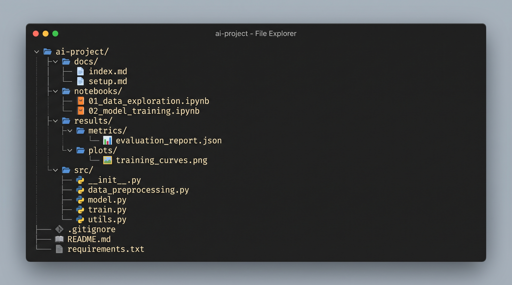

# F-PluvIA Metropolitan: Previsão Imediata (*Nowcasting*) de Precipitação na Região Metropolitana de Fortaleza com Modelo GPTCast-8x8 e Benchmark Interinstitucional

Repositório oficial dos artefatos de software, pipeline experimental de treinamento/inferência em GPU e certificação de proveniência científica do Trabalho de Conclusão de Curso (TCC), concebido no formato de **Artigo Científico**, apresentado ao Curso de Bacharelado em Ciência da Computação do **Instituto Federal de Educação, Ciência e Tecnologia do Ceará (IFCE) — Campus Maracanaú** (Semestre Letivo `2026.2`).

* **Autor:** Raul Santiago Pinheiro
* **Instituição:** IFCE — Campus Maracanaú (`2026.2`)
* **Orientação Acadêmica:** [Currículo Lattes CNPq](http://lattes.cnpq.br/2629504708221802)
* **Repositório Oficial:** [https://github.com/raulspinheiro/F-PluvIA-Metropolitan-GPTCast-TCC-IFCE-Maracanau](https://github.com/raulspinheiro/F-PluvIA-Metropolitan-GPTCast-TCC-IFCE-Maracanau)

---

## 1. Visão Geral do Projeto

O sistema **F-PluvIA Metropolitan** investiga a adaptação de domínio regional (*fine-tuning*) do modelo fundacional autorregressivo **GPTCast-8x8** (arquitetura híbrida composta por um *Tokenizer* Espacial **VQGAN** congelado de $90{,}71\text{ M}$ de parâmetros com *codebook* discreto de $1.024\text{ códigos}$ em grade latente $8 \times 8$, acoplado a um **Transformer Causal GPT-2** de $304{,}93\text{ M}$ de parâmetros) para a previsão imediata de precipitação severa (*nowcasting* de $+30\text{ min}$ a $+120\text{ min}$) sobre os 19 municípios da **Região Metropolitana de Fortaleza (RMF)**.

O estudo estabelece um protocolo experimental plurianual ($2019\text{–}2025$, $28\text{ meses}$ das quadras chuvosas de fevereiro a maio) utilizando estimativas de satélite **NASA GPM IMERG-FR v7** reamostradas para resolução espacial de $2\text{ km}$ ($128 \times 128\text{ pixels}$, cobrindo $256 \times 256\text{ km}$), avaliando a transferência de aprendizado em precisão mista `BF16` e realizando um benchmark interinstitucional e computacional em ambiente **Google Colab Pro+** (**NVIDIA RTX 6000 Blackwell / G4 — 95 GB GDDR7** vs. **NVIDIA H100 Hopper — 80 GB HBM3**).

---

## 2. Organização do Repositório

A estrutura de diretórios foi projetada segundo princípios de reprodutibilidade científica e rastreabilidade forense (`SHA-256`). Todos os diretórios e subdiretórios contam com documentação dedicada (`README.md` / `structure.md`):

```text
F-PluvIA-Metropolitan-GPTCast-TCC-IFCE-Maracanau/
├── README.md                        # Documentação principal e visão geral do projeto (este arquivo)
├── notebooks/
│   ├── README.md                    # Guia de execução do pipeline experimental (Células 1 a 13.1 + Extras)
│   └── Model_Annual_Full_Training_Series_TCC2_-_2026_2_-_RAUL_SANTIAGO_PINHEIRO.ipynb
├── src/
│   ├── README.md                    # Arquitetura modular em Python e visão geral dos pacotes
│   ├── adapters/
│   │   └── README.md                # Padrão GoF Adapter (IMERGToMiaradAdapter e PyStepsAdapter)
│   ├── metrics/
│   │   └── README.md                # Módulos de verificação contínua, categórica (CSI) e espacial (SAL, RAPSD, FSS)
│   └── utils/
│       └── README.md                # Conversão física Z-R (Marshall-Palmer) e cartografia da RMF (GeoPandas/Cartopy)
├── results/
│   ├── README.md                    # Índice geral dos artefatos experimentais e síntese de resultados
│   ├── figures/
│   │   └── README.md                # Catálogo dos painéis cartográficos e espectrais a 300 dpi
│   └── tables/
│       └── README.md                # Dicionário de dados dos relatórios CSV por horizonte (+30 a +120 min)
└── docs/
    ├── structure.md                 # Guia descritivo da estrutura e dos artefatos da pasta docs/
    ├── references.bib               # Base bibliográfica unificada em formato BibTeX (LaTeX/ABNT)
    └── provenance/
        ├── README.md                # Protocolo de auditoria forense e verificação de integridade SHA-256
        ├── certificado_autoria_*.json # Manifestos criptográficos de hardware e artefatos da sessão Colab Pro+
        └── certificado_autoria_*.md   # Relatórios legíveis de auditoria com tabelas de hashes SHA-256
```

---



## 3. Desenho Experimental e Particionamento Temporal Estrito

Para eliminar vazamento de dados (*data leakage*) e garantir avaliação meteorológica realista sob regimes convectivos tropicais (ZCIT, VCAN e Linhas de Instabilidade):

| Partição | Período (Quadra Chuvosa: Fev–Mai) | Volume Temporal | Finalidade Metodológica |
| :--- | :---: | :---: | :--- |
| **Treinamento** | $2019\text{–}2023$ | 20 meses | Ajuste fino (*fine-tuning*) do Transformer GPT-2 em precisão `BF16` com VQGAN congelado |
| **Validação** | $2024$ | 4 meses | Monitoramento de convergência, *Early Stopping* ($\text{val/loss} = 4{,}822$) e estudo de caso severo ($18/03/2024$) |
| **Teste Cego** | $2025$ | 4 meses ($1.729$ sequências) | Avaliação independente fora da amostra (*out-of-sample*) nos horizontes $+30, +60, +90\text{ e }+120\text{ min}$ |

---

## 4. Matriz de Benchmark e Verificação Multiescala

1. **Baselines e Modelos Comparados:** Persistência Euleriana, GPTCast-8x8 Zero-Shot (pesos nativos alpinos MIARAD), Extrapolação Lagrangiana por Fluxo Óptico Lucas-Kanade (`pysteps`), Modelo Estocástico Intradiário **LINDA** (*Pulkkinen et al., 2021*) e **GPTCast-8x8 Fine-Tuned (RMF)**.
2. **Intercomparação Institucional:** Referenciamento cruzado com dados de monitoramento da RMF (DECEA/Radar Banda S Eusébio, FUNCEME, CEMADEN, INMET, ANA e INPE/CPTEC).
3. **Métricas de Verificação:**
   * **Contínuas:** MAE ($\text{mm/h}$), RMSE ($\text{mm/h}$), SSIM e PCC.
   * **Categóricas de Alerta Defesa Civil (Limiares de $1{,}0$, $5{,}0$, $10{,}0$ e $20{,}0\text{ mm/h}$):** CSI (*Critical Success Index*), POD, FAR, F1-Score, HSS e ETS.
   * **Espaciais e Espectrais:** **RAPSD** (comprimento de onda de Nyquist em $4\text{ km}$), **SAL** (*Structure, Amplitude, Location* — *Wernli et al., 2008*) e **FSS** (*Fractions Skill Score* — *Roberts & Lean, 2008*, escalas de $2\text{ km}$ a $34\text{ km}$).

---

## 5. Como Citar este Trabalho (BibTeX)

```bibtex
@article{pinheiro2026fpluvia,
  author       = {Pinheiro, Raul Santiago},
  title        = {F-PluvIA Metropolitan: Nowcasting de Precipitação na Região Metropolitana de Fortaleza com Modelo GPTCast-8x8 e Benchmark Interinstitucional},
  journal      = {Trabalho de Conclusão de Curso (Bacharelado em Ciência da Computação) -- Instituto Federal de Educação, Ciência e Tecnologia do Ceará (IFCE), Campus Maracanaú},
  year         = {2026},
  address      = {Maracanaú, CE, Brasil},
  note         = {Semestre Letivo 2026.2. Repositório oficial: \url{[https://github.com/raulspinheiro/F-PluvIA-Metropolitan-GPTCast-TCC-IFCE-Maracanau](https://github.com/raulspinheiro/F-PluvIA-Metropolitan-GPTCast-TCC-IFCE-Maracanau)}}
}
```
