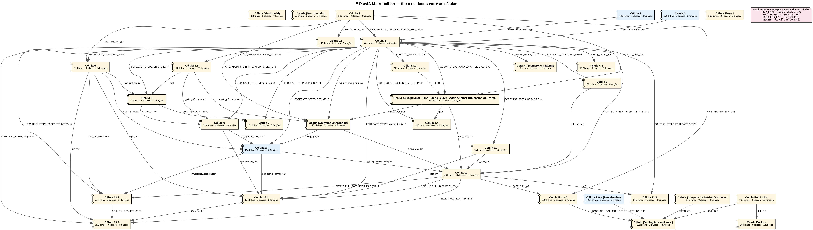

# Diagramas UML do F-PluvIA Metropolitan

Gerados automaticamente pela **Célula Full UMLs** a partir do código salvo de cada célula do notebook.

## Fluxo de dados entre as células

Cada caixa é uma célula (azul: define classes). Uma seta indica que a célula de destino usa variáveis criadas na de origem; o rótulo mostra até duas delas. Variáveis de configuração lidas por quase todas as células ficam na nota à parte.

## Diagramas por célula

| # | Célula | Linhas | Classes | Funções | Bibliotecas | Diagrama |
|---|---|---|---|---|---|---|
| 01 | Célula (Machine id) | 23 | 0 | 0 | 1 | [PNG](celulas/01_celula_machine_id.png) · [SVG](celulas/01_celula_machine_id.svg) |
| 02 | Célula (Security info) | 38 | 0 | 0 | 2 | [PNG](celulas/02_celula_security_info.png) · [SVG](celulas/02_celula_security_info.svg) |
| 03 | Célula 1 | 160 | 0 | 0 | 13 | [PNG](celulas/03_celula_1.png) · [SVG](celulas/03_celula_1.svg) |
| 04 | Célula (Limpeza de Saídas Obsoletas) | 143 | 0 | 0 | 8 | [PNG](celulas/04_celula_limpeza_de_saidas_obsoletas.png) · [SVG](celulas/04_celula_limpeza_de_saidas_obsoletas.svg) |
| 05 | Célula 2 | 426 | 1 | 0 | 12 | [PNG](celulas/05_celula_2.png) · [SVG](celulas/05_celula_2.svg) |
| 06 | Célula 3 | 373 | 3 | 0 | 12 | [PNG](celulas/06_celula_3.png) · [SVG](celulas/06_celula_3.svg) |
| 07 | Célula 4 | 401 | 0 | 0 | 15 | [PNG](celulas/07_celula_4.png) · [SVG](celulas/07_celula_4.svg) |
| 08 | Célula 4 (conferência rápida) | 6 | 0 | 0 | 2 | [PNG](celulas/08_celula_4_conferencia_rapida.png) · [SVG](celulas/08_celula_4_conferencia_rapida.svg) |
| 09 | Célula 4.1 | 241 | 0 | 2 | 8 | [PNG](celulas/09_celula_4_1.png) · [SVG](celulas/09_celula_4_1.svg) |
| 10 | Célula 4.2 | 152 | 0 | 1 | 6 | [PNG](celulas/10_celula_4_2.png) · [SVG](celulas/10_celula_4_2.svg) |
| 11 | Célula 4.3 (Opcional - Fine-Tuning Suave - Adds Another Dimension of Search) | 346 | 0 | 4 | 15 | [PNG](celulas/11_celula_4_3_opcional_fine_tuning_suave_adds_anot.png) · [SVG](celulas/11_celula_4_3_opcional_fine_tuning_suave_adds_anot.svg) |
| 12 | Célula 4.4 | 263 | 0 | 6 | 8 | [PNG](celulas/12_celula_4_4.png) · [SVG](celulas/12_celula_4_4.svg) |
| 13 | Célula 4.5 | 340 | 0 | 11 | 16 | [PNG](celulas/13_celula_4_5.png) · [SVG](celulas/13_celula_4_5.svg) |
| 14 | Célula (Activates Checkpoint) | 151 | 0 | 4 | 6 | [PNG](celulas/14_celula_activates_checkpoint.png) · [SVG](celulas/14_celula_activates_checkpoint.svg) |
| 15 | Célula 5 | 174 | 0 | 5 | 9 | [PNG](celulas/15_celula_5.png) · [SVG](celulas/15_celula_5.svg) |
| 16 | Célula 6 | 153 | 0 | 5 | 9 | [PNG](celulas/16_celula_6.png) · [SVG](celulas/16_celula_6.svg) |
| 17 | Célula 7 | 161 | 0 | 3 | 8 | [PNG](celulas/17_celula_7.png) · [SVG](celulas/17_celula_7.svg) |
| 18 | Célula 8 | 159 | 0 | 4 | 7 | [PNG](celulas/18_celula_8.png) · [SVG](celulas/18_celula_8.svg) |
| 19 | Célula 9 | 216 | 0 | 3 | 8 | [PNG](celulas/19_celula_9.png) · [SVG](celulas/19_celula_9.svg) |
| 20 | Célula 10 | 158 | 1 | 0 | 8 | [PNG](celulas/20_celula_10.png) · [SVG](celulas/20_celula_10.svg) |
| 21 | Célula 11 | 144 | 0 | 4 | 6 | [PNG](celulas/21_celula_11.png) · [SVG](celulas/21_celula_11.svg) |
| 22 | Célula 12 | 464 | 0 | 11 | 16 | [PNG](celulas/22_celula_12.png) · [SVG](celulas/22_celula_12.svg) |
| 23 | Célula 12.1 | 151 | 0 | 3 | 4 | [PNG](celulas/23_celula_12_1.png) · [SVG](celulas/23_celula_12_1.svg) |
| 24 | Célula 13 | 149 | 0 | 3 | 6 | [PNG](celulas/24_celula_13.png) · [SVG](celulas/24_celula_13.svg) |
| 25 | Célula 13.1 | 594 | 0 | 17 | 20 | [PNG](celulas/25_celula_13_1.png) · [SVG](celulas/25_celula_13_1.svg) |
| 26 | Célula 13.2 | 259 | 0 | 4 | 4 | [PNG](celulas/26_celula_13_2.png) · [SVG](celulas/26_celula_13_2.svg) |
| 27 | Célula 13.3 | 245 | 0 | 4 | 6 | [PNG](celulas/27_celula_13_3.png) · [SVG](celulas/27_celula_13_3.svg) |
| 28 | Célula Extra 1 | 268 | 0 | 6 | 14 | [PNG](celulas/28_celula_extra_1.png) · [SVG](celulas/28_celula_extra_1.svg) |
| 29 | Célula Full UMLs | 397 | 0 | 13 | 14 | [PNG](celulas/29_celula_full_umls.png) · [SVG](celulas/29_celula_full_umls.svg) |
| 30 | Célula Extra 2 | 278 | 0 | 5 | 13 | [PNG](celulas/30_celula_extra_2.png) · [SVG](celulas/30_celula_extra_2.svg) |
| 31 | Célula Base (Pseudo-vista) | 364 | 1 | 5 | 14 | [PNG](celulas/31_celula_base_pseudo_vista.png) · [SVG](celulas/31_celula_base_pseudo_vista.svg) |
| 32 | Célula (Deploy Automatizado) | 312 | 0 | 4 | 12 | [PNG](celulas/32_celula_deploy_automatizado.png) · [SVG](celulas/32_celula_deploy_automatizado.svg) |
| 33 | Célula Backup | 189 | 0 | 1 | 12 | [PNG](celulas/33_celula_backup.png) · [SVG](celulas/33_celula_backup.svg) |

## Como ler

- **«célula»**: no 1º compartimento, as variáveis que a célula deixa disponíveis para as seguintes; no 2º, as funções que ela define (operações).
- **«classe»**: atributos e métodos (+ público, - interno). Losango: a célula define a classe. Triângulo vazado: herança.
- **bibliotecas** («import»), **usa de outras células** («use») e **arquivos citados** completam o contexto.
- Diagramas de sequência e de atividade não são gerados, porque dependeriam de rastrear a execução.
